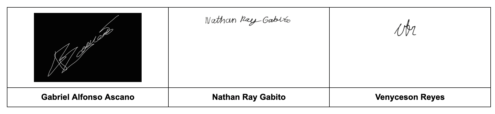

# B2030-9---K-CS3-Project
## Project Proposal Template

<b>Project Title or 
Name of the Application</b>	: The Crimson Court of Caerwick  
<b>Section</b>			   	: 9 - Potassium  
<b>Group Members</b>			: Gabriel Alfonso Ascano, Nathan Ray Gabito, and Venyceson Reyes  	
<b>Date (Proposal Date)</b>	: November 21, 2026 

## Project Description:
The Crimson Court of Caerwick is a low fantasy medieval RPG game set in the fictional Kingdom of Caerwick following the death of King Edric “the Just” III and the subsequent succession crisis. Players assume the role of an adventurer whose decisions, alliances, and actions influence the kingdom's political landscape. They can select a character class, acquire equipment, complete quests, interact with non-player characters (NPCs), engage in turn-based combat, and explore the kingdom's diverse regions. The game primarily takes place in Aurecourt, the kingdom's capital and center of political power, where competing noble houses struggle for influence over the vacant throne.

The project aims to provide an fun, engaging, and interactive entertainment experience through exploration, character progression, and consequential decision-making. It will also serve as an application of Python object-oriented programming (OOP) with the use of classes, attributes, methods, inheritance, encapsulation, inheritance, polymorphism, and more to create and build the game.

## Classes:
<u><b>Character Class:</b></u>
  This is the class the people that interact will have. They have 7 attributes and 2 methods:
  <ul>
   <li> Attributes: Their name as a string, their health points and rawattack points as integers, their x position and y position as integers to track their movement, their specialAbility as a string, and their Allied_House as a string. </li>
<li>Methods: 
<ul>
  <li style="list-style-type: square;">move(): This is used for them to move around the kingdom and interact with the NPCs.</li> 
  <li style="list-style-type: square;">faint(): When a player gets 0 HP, they will be transported to a clinic, and will have to wait for a bit until they play again.</li>
</ul>
</li>
<li>Two classes inherit from Character: Player and NPC</li>
</ul>  
  <b><u>Player Class:</u></b>
  <ul>
    </li>This is the class the user will control. Player inherits all attributes from the Character, with addition to an inventory full of the weapons they use. All methods are also inherited, with addition to two new methods. The first one is an encounter method, which is executed when the Player goes near an Enemy. This makes the Player dependent on an NPC. There is also a flee method, allowing the player to run away from these encounters.</li> </ul>ul> 
 <b><u>NPC Class:</u></b>
 <ul>
    <li>NPC inherits all methods and attributes from Character. However, the move method is now at random because no one controls the NPC.</li> 
 </ul>
    The NPC is very important because it interacts with many other classes for both game and story progression:
<ul>
  <li>Offensive and Miscellaneous inherit from NPC:</li>
	<ul>
    <li> The <u><b>Offensive class</b></u> is a class that can deal damage and make a player faint whenever the two interact: </li>
		<ul>
      <li>Its attributes and methods are all inherited from NPC, with addition to a “damage” attribute which is an integer that adds on to the rawattack attribute at random. This determines how many health points the Player loses when it attacks. </li>
      <li>One more class inherits from the Offensive Class: Soldiers</li>
	<ul>
        <li>The <u><b>Soldiers class</b></u> inherit everything from the offensive class, but there is an extraEncounter()  method that makes it easier to encounter compared to other NPCs.</li>
        <ul><li>Soldiers can also be <u><b>Knights</b></u>, which inherit everything from the soldiers, but have better stats (health and damage) overall
		</li></ul>
		</ul>
	</ul>

<li>The <b><u>Miscellaneous Class</u></b> on the other hand:</li>
  <ul><li>Are those that are incapable of doing damage to the player character. Rather, they serve as support characters, or peons for the plot of the story, but still help with its progression. However, they still inherit every    attribute and method from NPC except for “rawattack.” and move().</li>
  <li>In our shown class diagram, 3 other classes inherit from this, namely:</li>  
   <ul> <li><u><b>Quest Giver:</b></u> This will serve as the main class for characters in our game that will give quests through the method assignQuest(). It doesn’t move and forms a multilevel inheritance with Character, through NPC, and         then Miscellaneous, inheriting its attributes such as health, x and y position, name and joined kingdom. In addition, quest giver has a Composition relationship with Class Quest.</li>
	   <ul>
        <li><b><u>Class Quest:</u></b>
          This class contains all key properties and attributes of an ideal quest in our game, which includes the quest string or statement. And to reward players, upon completion, a reward may be given by completing the            quest. </li>
	   </ul> 
    <li><u><b>Thief:</b></u> This class also undergoes a multilevel inheritance with Character, through NPC and Miscellaneous to inherit name, x and y position, joined kingdom, and health attributes. In order to make this character more        unique, we gave it the ability to steal/plunder, move and faint through the methods plunder(), faint() and move(). </li> 
    <li> <u><b>Trader:</b></u> The Trader class brings life to a new character as it inherits all its attributes from Character, giving it health, an x and y position and which house it belongs to. It allows the player to trade with it          through method trade(), and doesn’t move places for convenience. </li> 
   </ul>
  </ul>
	</ul>
	

<li>House Classes contain NPCs in an aggregation relationship:
	<ul>
  <li>It has 3 attributes and 2 methods:</li>
		<ul>
    <li>Attributes: An NPC house_ruler, a house_members list filled with NPCs and the Player, and the house name as a string.</li>
    <li>Methods: There is one method to join an alliance with another House to form a bigger list of Houses, or declare war on a house. Depending on where the player joins, these declarations could be random because other       Houses could declare war on the player’s house.</li>
		</ul>
   <li> <ul>Houses could be “Allied Houses” or “Opposing Houses depending on the alliance you have with them: </li>
        <li>AlliedHouse Classes inherit everything from the normal house, but it also includes the x and y positions of the house as integers. In addition, it also has the method recruitAllies(), which allows you to recruit           more members for the houses.</li>
        <li>Opposing House Classes are Houses that your alliance houses have declared war on. They inherit everything from the House, and it also contains x and y positions as integer attributes.</ul></ul></li>
</ul>

The intended users are players interested in medieval fantasy, RPGs, exploration, and narrative-driven experiences or just anyone who enjoys interactive storytelling and strategic decision-making.

## Goals:
Objective 1: By the end of project development period, we want to make a playable 2D top down low fantasy medieval RPG European-inspired setting with at least three explorable and interactive settings, five interactive non-playable characters (NPCs), and two distinct main factions, each with its own identity and interests, showing the application of python object-oriented programming (OOP) and worldbuilding.

Objective 2: By the end of project development period, we want to make at least four main gameplay systems, namely, character progression, inventory management, quest management, and turn-based combat, showing the application of python object-oriented programming (OOP) and worldbuilding.

Objective 3: By the end of project development period, we want to make at least three conquestial player decisions that 
	affect the storyline, faction relationships, and quest outcomes. We also want to make at least two distinct possible endings. 
	We will validate the game’s functionality through systematic play testing.

## Signatures:

## Message for Sir Roy:
Hi Sir. Roy! We hope you like this project proposal because we’re actually quite passionate about it! All of us in our group are quite interested in these types of “interactive RPGs” and the worldbuilding behind them, so it would be <b>REALLLLLLY</b> cool if you liked it too po!!! Thank you!!!

Google Document Project Proposal Link: https://docs.google.com/document/d/1OYx6tYv5j-dMb8ukUuVH995kG_sb6tQgWylzicBD3i0/edit?tab=t.0

